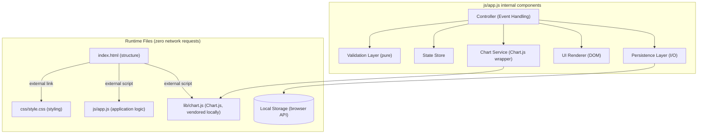
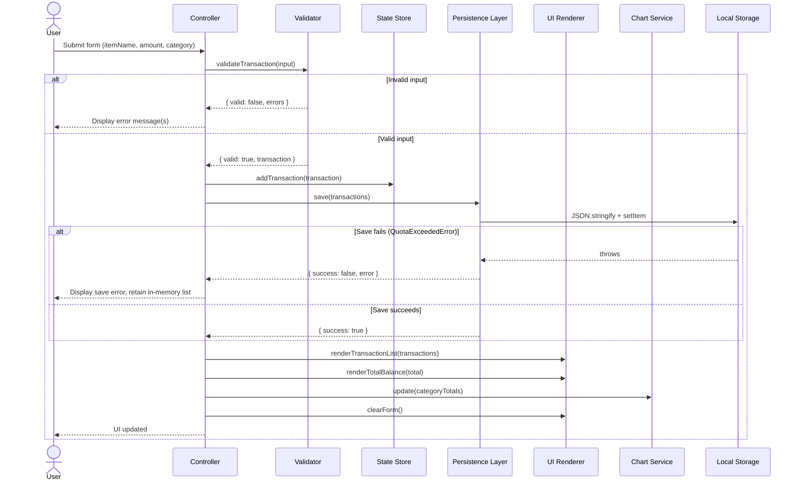
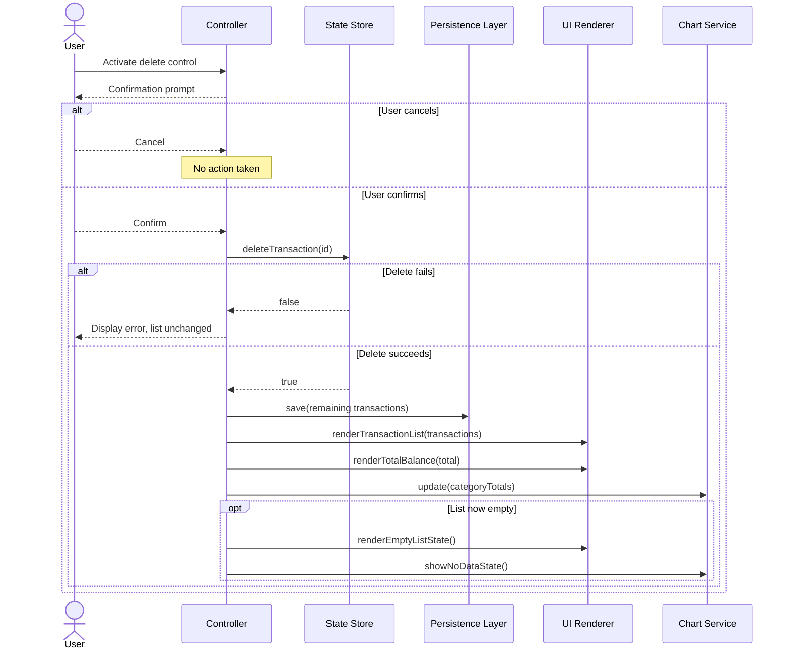
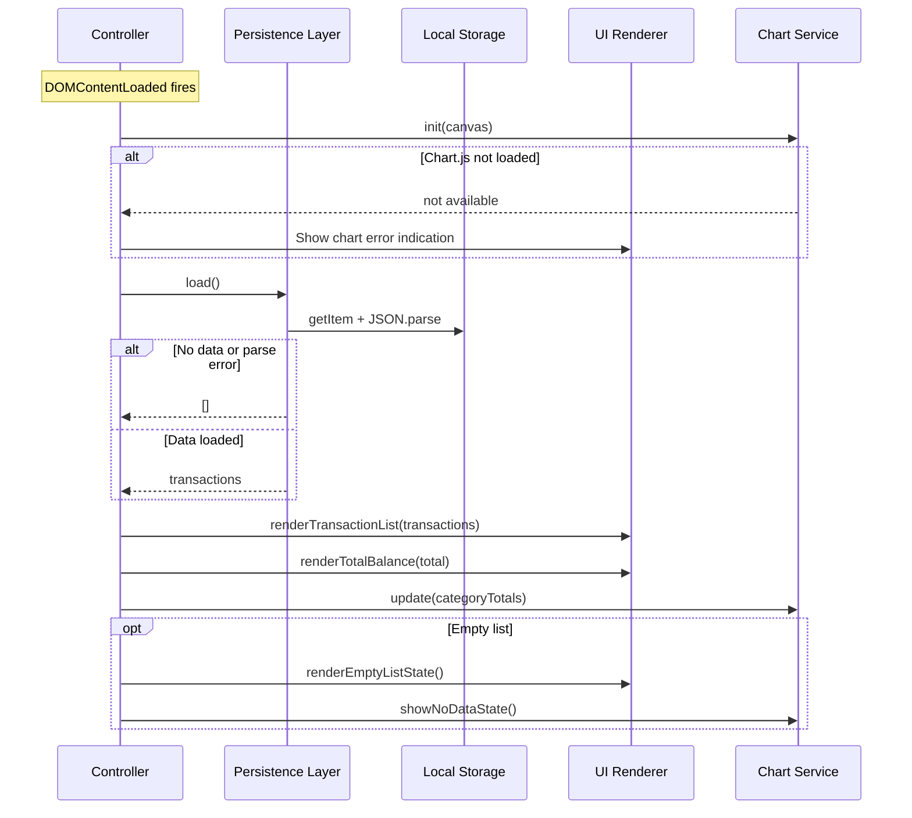

# Design Document

## Introduction

This design describes the technical architecture, components, data models, and testing approach for the Expense & Budget Visualizer, a client-side web application built with HTML, CSS, and Vanilla JavaScript. It is derived directly from the requirements document and addresses every functional and non-functional requirement.

## Overview

The Expense & Budget Visualizer is a client-side web application that lets users record expense transactions, monitor a running total balance, browse a scrollable history of transactions, and visualize spending distribution by category through a pie chart. The application runs entirely in the browser: it persists data in Local Storage, renders the pie chart with the Chart.js library, and makes zero network requests to any external server.

The design centers on a clear separation between **pure business logic** (input validation, balance computation, category aggregation, serialization) and **impure side-effecting operations** (DOM rendering, Local Storage I/O, chart rendering). This separation keeps the runtime app dependency-free and testable: the pure functions are verifiable through property-based testing across a wide input space, while the UI, persistence, and chart integration concerns are covered by example-based and integration tests.

The application targets modern browsers (Chrome, Firefox, Edge, Safari) using their two most recent stable major versions. Chart.js is bundled locally in a `lib/` directory to satisfy the zero-network-requests constraint and to allow graceful degradation if the library fails to load.

## Architecture

The application follows a single-page, client-only architecture with no server component. All state lives in the browser as an in-memory transaction list backed by Local Storage for cross-session persistence.

### High-Level Architecture



### Key Architectural Decisions

1. **Single-file JavaScript with testable pure functions.** Requirement 9 mandates exactly one application JavaScript file in `js/`. To keep that file testable in a Node test runner, all pure logic (validation, computation, aggregation, serialization) is written as standalone functions with no DOM dependency, and a conditional CommonJS export is appended for the test environment. In the browser, the file attaches a namespace to `window` and runs DOM initialization guarded by a `document` existence check. This lets property-based tests import and exercise the pure functions without triggering any DOM code.

2. **Local Chart.js bundling.** Requirement 7.4 (zero external network requests) and Requirement 8.4 (graceful handling of Chart_Library load failure) require Chart.js to be vendored locally rather than loaded from a CDN. The library is placed in `lib/chart.js` and referenced via a separate `<script>` tag. This does not violate the single-JS-file constraint (Requirement 9.2), which governs the application's own code in `js/`; the vendored library lives in `lib/`. Load failure is detected by checking `typeof Chart !== 'undefined'` before initialization.

3. **Pure/impure separation.** Validation, total-balance computation, category aggregation, and serialization/deserialization are pure functions that take inputs and return outputs with no side effects. Persistence, DOM rendering, and chart rendering are isolated behind service boundaries. The Controller orchestrates between them. This separation is what makes property-based testing feasible for the core logic.

4. **Monetary precision via rounding.** JavaScript uses IEEE-754 double-precision floats, so summing decimal monetary values can introduce representation errors (for example, `0.1 + 0.2 = 0.30000000000000004`). All monetary sums (total balance and per-category totals) are computed with a rounding helper that rounds to two decimal places: `Math.round(value * 100) / 100`. Individual transaction amounts are stored as-is, and JSON serialization preserves numeric values exactly on round-trip, so the rounding concern is confined to aggregation computations.

5. **Identifier generation for deletion.** Each transaction is assigned a unique `id` so delete operations target a specific record rather than a fragile array index. IDs are generated with `crypto.randomUUID()` (available in all targeted modern browsers), with a timestamp-plus-random fallback for robustness.

### Data Flow

#### Add Transaction



#### Delete Transaction



#### Application Load



## Components and Interfaces

The entire application resides in `js/app.js`. Internally it is organized into six logical components. Pure components (Validation Layer) have no DOM or storage dependency and are the primary target of property-based testing.

### 1. Validation Layer (pure)

Validates raw form input and either rejects it with descriptive errors or produces a normalized `Transaction` object. This is a pure function: identical input always yields identical output.

- `validateTransaction(input: RawInput): ValidationResult`
  - Trims all fields. Rejects if any field is empty or whitespace-only (Requirement 1.4). Parses the amount and rejects if it is non-numeric, below `0.01`, or above `999,999,999.99` (Requirement 1.5). Rejects if `itemName` exceeds 100 characters (Requirement 1.1). Rejects if `category` is not one of the three valid values (Requirement 1.2). On success, returns `{ valid: true, transaction }`.
- `isValidAmount(amountStr: string): boolean` — checks numeric and bounds.
- `isEmptyOrWhitespace(str: string): boolean` — helper.

```
interface RawInput {
  itemName: string;
  amount: string;    // raw string from the form field
  category: string;
}

interface ValidationResult {
  valid: boolean;
  errors: string[];            // human-readable error messages
  transaction?: Transaction;   // present when valid === true
}
```

### 2. State Store

Holds the in-memory transaction list and provides query and mutation operations. Mutation operations are the single source of truth that the Controller reads before rendering.

- `addTransaction(transaction: Transaction): void` — appends to the end, preserving insertion order (Requirement 2.4).
- `deleteTransaction(id: string): boolean` — removes the matching transaction; returns `true` on success, `false` if not found (Requirement 3.4).
- `getTransactions(): Transaction[]` — returns a defensive copy.
- `getTotalBalance(): number` — returns the sum of all amounts, rounded to two decimals (Requirement 4.2).
- `getCategoryTotals(): CategoryTotals` — returns per-category sums, rounded to two decimals (Requirement 5.1).

### 3. Persistence Layer (I/O)

Serializes and deserializes the transaction list to and from Local Storage, with all operations wrapped in try/catch to handle `QuotaExceededError`, private-browsing failures, and corrupt data.

- `STORAGE_KEY: string` — the Local Storage key, e.g. `"expense-visualizer:transactions"`.
- `save(transactions: Transaction[]): SaveResult` — serializes to JSON and writes; catches `QuotaExceededError`/`SecurityError`; returns `{ success: boolean, error?: string }` (Requirement 6.1, 6.6).
- `load(): Transaction[]` — reads and parses JSON; returns `[]` when the key is absent (Requirement 6.5) or when parsing fails; never throws.

```
interface SaveResult {
  success: boolean;
  error?: string;
}
```

### 4. UI Renderer (DOM)

Renders the transaction list, total balance, empty states, and manages form clearing. Reads data passed in by the Controller; never reads state directly.

- `renderTransactionList(transactions: Transaction[]): void` — clears the container and appends one row per transaction showing Item Name, Amount, and Category, each with a delete control (Requirement 2.1, 2.2, 3.1). Shows the empty-state indicator when the list is empty (Requirement 2.5, 3.3).
- `renderTotalBalance(amount: number): void` — updates the balance display, formatted to two decimals (Requirement 4.1, 4.4).
- `renderEmptyListState(): void` — shows the "no transactions" indication.
- `clearForm(): void` — clears all input fields after a successful add (Requirement 1.6).
- `showError(message: string): void` — displays an error message for validation/save/delete failures.
- `clearError(): void` — removes any displayed error message.

### 5. Chart Service (Chart.js wrapper)

Manages the Chart.js pie chart instance and handles the no-data and load-failure states.

- `init(canvas: HTMLCanvasElement): void` — creates the pie chart if `Chart` is defined; otherwise enters a load-failed state (Requirement 8.4).
- `update(categoryTotals: CategoryTotals): void` — refreshes the chart data and labels; shows only categories with a positive total (Requirement 5.2); shows the no-data state when all totals are zero (Requirement 5.4).
- `showNoDataState(): void` — displays the "no spending data available" indication in place of the chart.
- `showLoadFailure(): void` — displays an error indication that the chart could not be rendered while keeping Total_Balance and Transaction_List visible (Requirement 8.4).
- `isAvailable(): boolean` — reports whether Chart.js loaded.

### 6. Controller / Event Handler

Orchestrates the flow between components on user actions and on application load.

- `handleSubmit(event: Event): void` — reads form values, calls `validateTransaction`, and on success adds to the State Store, saves via the Persistence Layer, re-renders the list/balance/chart, and clears the form. On failure, displays the validation error and leaves the list unchanged.
- `handleDelete(id: string): void` — shows a confirmation prompt; on confirmation deletes from the State Store, saves, re-renders, and shows the empty state if the list became empty. On failure, displays an error and retains the list.
- `init(): void` — on `DOMContentLoaded`, loads transactions from Local Storage, renders the initial list/balance/chart, initializes the Chart Service, and wires up form and list event listeners (Requirement 6.2).

## Data Models

### Transaction

The core domain object. Stored in memory, serialized to JSON in Local Storage, and rendered in the UI.

```
interface Transaction {
  id: string;          // Unique identifier (crypto.randomUUID() or fallback)
  itemName: string;    // User label, trimmed, max 100 characters
  amount: number;      // Monetary value, 0.01 <= amount <= 999,999,999.99
  category: Category;  // "Food" | "Transport" | "Fun"
}
```

- `id`: generated at creation time; used to target deletion. Never edited after creation.
- `itemName`: stored trimmed; length enforced at validation time.
- `amount`: stored as a number. JSON serialization and parsing preserve the value exactly on round-trip; sums are rounded at computation time, not at storage time.
- `category`: constrained to the three valid values by the validation layer and by the `<select>` input.

### Category

The set of valid transaction categories.

```
type Category = "Food" | "Transport" | "Fun";
const CATEGORIES: Category[] = ["Food", "Transport", "Fun"];
```

### CategoryTotals

The aggregated spending per category, used to feed the pie chart. Only categories with a positive total produce a chart segment.

```
interface CategoryTotals {
  Food: number;
  Transport: number;
  Fun: number;
}
```

### ValidationResult

The output of the validation layer.

```
interface ValidationResult {
  valid: boolean;
  errors: string[];
  transaction?: Transaction;
}
```

### SaveResult

The output of the persistence layer's save operation.

```
interface SaveResult {
  success: boolean;
  error?: string;
}
```

### Persisted Format

Transactions are serialized to a JSON array in Local Storage under a single key. The array order encodes insertion order and is preserved by JSON serialization.

```json
[
  { "id": "a1b2c3...", "itemName": "Lunch", "amount": 12.5, "category": "Food" },
  { "id": "d4e5f6...", "itemName": "Bus fare", "amount": 3.0, "category": "Transport" }
]
```

### Project File Layout

```
/
├── index.html            # Structure; references CSS and JS externally
├── css/
│   └── style.css         # Single CSS file (Requirement 9.1)
├── js/
│   └── app.js            # Single application JS file (Requirement 9.2)
├── lib/
│   └── chart.js          # Chart.js, vendored locally (zero network requests)
└── (test tooling lives outside js/, e.g. package.json, tests/ at root)
```

The `lib/chart.js` vendor file is referenced by `index.html` as a separate `<script>` and does not count against the single-application-JS-file constraint, which applies only to code in `js/`.

## Correctness Properties

*A property is a characteristic or behavior that should hold true across all valid executions of a system—essentially, a formal statement about what the system should do. Properties serve as the bridge between human-readable specifications and machine-verifiable correctness guarantees.*

The pure-logic layer of the Expense & Budget Visualizer (validation, balance computation, category aggregation, and serialization) is amenable to property-based testing. The following properties were derived from the acceptance criteria via prework analysis, with redundant criteria consolidated. UI rendering, Local Storage I/O, and chart rendering are covered by example-based, integration, and smoke tests described in the Testing Strategy.

### Property 1: Valid transaction addition grows the list

*For any* transaction input with non-empty fields and an amount in the valid range `[0.01, 999999999.99]`, validation succeeds and adding the resulting transaction increases the transaction list length by exactly one, with the new transaction present in the list.

**Validates: Requirements 1.3, 2.3**

### Property 2: Whitespace-only fields are rejected

*For any* transaction input where at least one field (Item Name, Amount, or Category) is empty or composed entirely of whitespace characters, validation fails and the transaction list remains unchanged.

**Validates: Requirements 1.4**

### Property 3: Out-of-range or non-numeric amounts are rejected

*For any* transaction input whose Amount field is not a numeric value, or parses to a number less than `0.01`, or parses to a number greater than `999999999.99`, validation fails and the transaction list remains unchanged.

**Validates: Requirements 1.5**

### Property 4: Transaction row display includes all fields

*For any* transaction, the generated row display content includes the transaction's Item Name, its formatted Amount, and its Category.

**Validates: Requirements 2.2**

### Property 5: Insertion order is preserved

*For any* sequence of valid transactions added in a given order, the resulting transaction list presents them in that same order, with the first-added transaction appearing first.

**Validates: Requirements 2.4**

### Property 6: Total balance equals the sum of all amounts

*For any* transaction list (including the empty list), the computed total balance equals the sum of all transaction amounts rounded to two decimal places; for the empty list the total is zero.

**Validates: Requirements 4.2, 4.4**

### Property 7: Category totals equal per-category sums with only positive-total segments

*For any* transaction list, each category's total equals the sum of the amounts of all transactions in that category (rounded to two decimals), and the set of chart segments corresponds exactly to the categories whose total is greater than zero.

**Validates: Requirements 5.1, 5.2**

### Property 8: Serialization round-trip preserves transactions

*For any* transaction list, serializing the list to JSON and deserializing it back produces a list with the same number of transactions and matching `id`, `itemName`, `amount`, and `category` field values.

**Validates: Requirements 6.4**

## Error Handling

The application distinguishes three categories of errors: input validation errors, persistence errors, and component-load failures. Each is surfaced to the user with a descriptive message while preserving data integrity.

### Input Validation Errors

Handled by the Validation Layer before any state mutation occurs. The transaction list is never modified on a validation failure.

| Condition | Trigger | Behavior |
|---|---|---|
| Empty or whitespace-only field (Requirement 1.4) | Any of Item Name, Amount, or Category is empty or whitespace-only after trimming | Reject submission; display an error message naming the empty field(s); leave the form and list unchanged |
| Non-numeric amount (Requirement 1.5) | Amount field does not parse to a finite number | Reject submission; display an error message indicating the Amount is invalid |
| Amount below minimum (Requirement 1.5) | Parsed amount < `0.01` | Reject submission; display an error message indicating the Amount is invalid |
| Amount above maximum (Requirement 1.5) | Parsed amount > `999999999.99` | Reject submission; display an error message indicating the Amount is invalid |
| Item Name too long (Requirement 1.1) | Trimmed Item Name exceeds 100 characters | Reject submission; display an error message indicating the Item Name is too long |
| Invalid Category (Requirement 1.2) | Category is not one of Food, Transport, Fun | Reject submission; display an error message indicating the Category is invalid |

### Persistence Errors

Handled by the Persistence Layer with try/catch around all Local Storage operations. The in-memory transaction list is the source of truth for the active session regardless of storage failures.

| Condition | Trigger | Behavior |
|---|---|---|
| Save quota exceeded / private browsing (Requirement 6.6) | `localStorage.setItem` throws `QuotaExceededError` or `SecurityError` | Display an error message indicating the save failed; retain the current in-memory transaction list for the session |
| Corrupt stored data on load | `JSON.parse` throws on load | Log the parse error; initialize the transaction list as empty; do not crash |
| Missing stored data (Requirement 6.5) | `localStorage.getItem` returns `null` | Initialize the transaction list as empty |

### Component-Load Failures

| Condition | Trigger | Behavior |
|---|---|---|
| Chart.js fails to load (Requirement 8.4) | `typeof Chart === 'undefined'` at initialization | Render Total_Balance and Transaction_List normally; display an error indication in the Pie_Chart region stating the chart could not be rendered |
| Deletion fails (Requirement 3.4) | `deleteTransaction` returns `false` (id not found) | Display an error message; retain the current transaction list unchanged |

### Error Display Mechanism

A single `showError(message)` function displays error messages in a dedicated, non-overlapping region (not a modal that could obscure the four named components). Errors are cleared via `clearError()` before any new submission or successful operation so that stale errors do not persist.

## Testing Strategy

### Dual Testing Approach

The testing strategy combines property-based tests for universal logic invariants with example-based unit tests, integration tests, and smoke tests for concerns that are not amenable to PBT.

**Property-based tests** cover the pure-logic layer (Properties 1 through 8). **Unit tests** cover specific examples, edge cases, and error conditions. **Integration tests** cover Local Storage persistence and chart rendering with mocked dependencies. **Smoke tests** cover architectural and structural constraints.

### Testing Frameworks

- **Vitest** — test runner with native ESM support and fast execution.
- **fast-check** — property-based testing library for the universal properties.
- **jsdom** — DOM simulation for renderer and controller integration tests.

Test tooling configuration (`package.json`, `vitest.config.js`, `tests/`) lives at the project root, outside `js/`, and does not affect the zero-network-requests runtime constraint.

### Testability of Pure Functions

The single `js/app.js` file exposes pure functions for testing via a conditional CommonJS export appended at the end of the file:

```js
// js/app.js — pure functions have no DOM dependency
function validateTransaction(input) { /* ... */ }
function computeTotalBalance(transactions) { /* ... */ }
function aggregateByCategory(transactions) { /* ... */ }
function serializeTransactions(transactions) { /* ... */ }
function deserializeTransactions(json) { /* ... */ }

// DOM-dependent initialization runs only in a browser/DOM environment
if (typeof document !== 'undefined') {
  document.addEventListener('DOMContentLoaded', init);
}

// Export pure functions for the Node test environment
if (typeof module !== 'undefined' && module.exports) {
  module.exports = {
    validateTransaction, computeTotalBalance, aggregateByCategory,
    serializeTransactions, deserializeTransactions
  };
}
```

This pattern lets property tests import and exercise the pure functions without triggering any DOM code, while the browser runtime attaches the same functions to `window` and runs initialization guarded by a `document` existence check.

### Property-Based Tests

Each correctness property is implemented as a single fast-check property test. Each test references its design document property via a tag comment.

**Configuration:**
- Minimum 100 iterations per property test (fast-check default `numRuns`).
- Generators produce random transaction inputs across the full valid input space: item names of varied content and length (up to 100 characters), amounts across `[0.01, 999999999.99]`, all three categories, and whitespace/error strings for rejection properties.

**Tag format:** `Feature: expense-budget-visualizer, Property {number}: {property_text}`

Example property test structure:

```js
const fc = require('fast-check');
const { validateTransaction } = require('../js/app.js');

// Feature: expense-budget-visualizer, Property 1: Valid transaction addition grows the list
test('Property 1: valid transaction addition grows the list', () => {
  fc.assert(fc.property(
    fc.record({
      itemName: fc.string({ maxLength: 100 }).filter(s => s.trim().length > 0),
      amount: fc.float({ min: 0.01, max: 999999999.99, noDefaultInfinity: true }),
      category: fc.constantFrom('Food', 'Transport', 'Fun'),
    }),
    (input) => {
      const result = validateTransaction({ ...input, amount: String(input.amount) });
      return result.valid === true && result.transaction !== undefined;
    }
  ), { numRuns: 100 });
});
```

### Unit Tests (Example-Based)

Unit tests cover specific examples, edge cases, and error conditions not expressed as universal properties:

| Test | Type | Validates |
|---|---|---|
| Form contains Item Name (maxlength 100), Amount, and Category fields | Example | 1.1 |
| Category select offers exactly Food, Transport, Fun | Example | 1.2 |
| Form fields cleared after successful add | Example | 1.6 |
| Transaction_List container is scrollable | Example | 2.1 |
| Empty list shows empty-state indication | Edge case | 2.5 |
| Each row has a delete control | Example | 3.1 |
| Delete shows confirmation, confirm removes transaction | Example | 3.2 |
| Deleting last transaction shows empty-state indication | Edge case | 3.3 |
| Failed deletion shows error, list unchanged | Edge case | 3.4 |
| Total_Balance displayed at top of interface | Example | 4.1 |
| Total balance updates within 1 second on add/delete | Smoke | 4.3 |
| Empty list shows no-data state for chart | Edge case | 5.4 |
| Chart updates within 2 seconds on add/delete | Smoke | 5.3 |
| No saved data initializes list as empty | Edge case | 6.5 |
| Save failure shows error, retains in-memory list | Edge case | 6.6 |
| Four components occupy distinct non-overlapping regions | Example | 7.1 |
| Font sizes >= 16px and contrast >= 4.5:1 | Example | 7.2 |
| Submit updates all components without page reload | Smoke | 7.3 |
| Zero external network requests | Smoke | 7.4 |
| Chart rendered via Chart.js (type 'pie') | Example | 8.3 |
| Chart.js absent: balance + list render, chart error shown | Edge case | 8.4 |

### Integration Tests

| Test | Validates |
|---|---|
| After add and after delete, save is called with updated list (mocked localStorage) | 6.1 |
| On start, transactions loaded from localStorage populate the list (mocked localStorage) | 6.2 |
| Total balance displays as numeric, list entries show amount + category, chart segments proportional (jsdom structure + cross-browser manual) | 8.1 |

### Smoke Tests

| Test | Validates |
|---|---|
| No backend/network calls; uses Local Storage API only | 6.3 |
| Uses HTML, CSS, Vanilla JS; no application frameworks | 8.2 |
| Exactly one CSS file in `css/` | 9.1 |
| Exactly one application JS file in `js/` | 9.2 |
| No inline CSS or inline JS in `index.html` | 9.3 |
| HTML references CSS and JS via external `<link>` and `<script src>` | 9.4 |

### Accessibility Testing Note

Full WCAG conformance for Requirement 7.2 (contrast ratio, font size) requires manual testing with assistive technologies and expert accessibility review. The automated unit test verifies computed font sizes and calculates contrast ratios programmatically, but this does not replace manual validation.

### Property/Requirement Traceability

| Property | Validates Requirements |
|---|---|
| Property 1: Valid transaction addition grows the list | 1.3, 2.3 |
| Property 2: Whitespace-only fields are rejected | 1.4 |
| Property 3: Out-of-range or non-numeric amounts are rejected | 1.5 |
| Property 4: Transaction row display includes all fields | 2.2 |
| Property 5: Insertion order is preserved | 2.4 |
| Property 6: Total balance equals the sum of all amounts | 4.2, 4.4 |
| Property 7: Category totals with positive-total segments only | 5.1, 5.2 |
| Property 8: Serialization round-trip preserves transactions | 6.4 |
